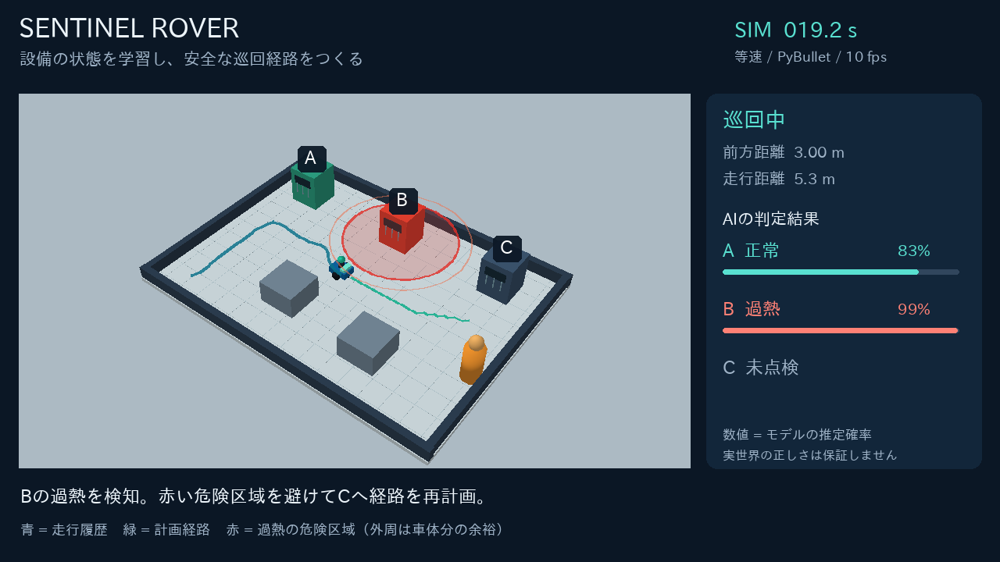
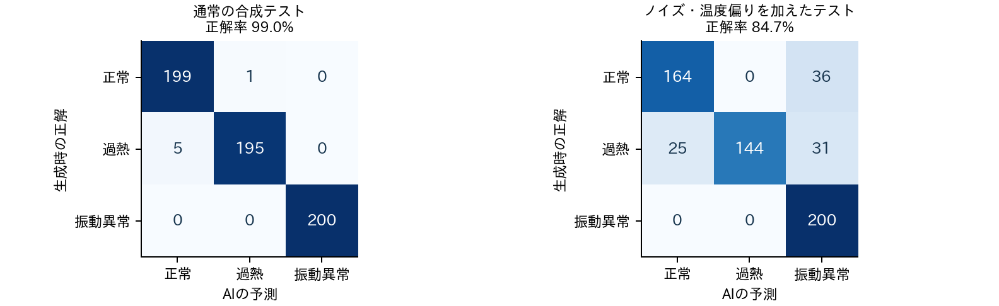
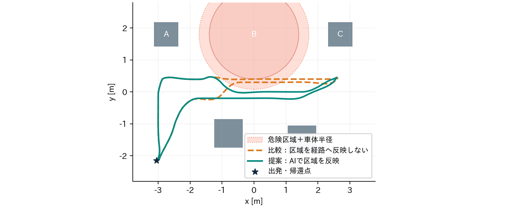

# SENTINEL ROVER

AIで設備の異常を判別し、危険を避けて巡回する点検ロボット

学習済みAI × 差動二輪ロボット × 危険区域を反映する経路計画

## 1. 目的と実現したタスク

工場・倉庫の点検を題材に、単に異常を表示するだけでなく、AIの判定で移動の方針を変更するロボットを設計した。3台の設備を順番に点検し、過熱設備を避けて出発地点へ戻る。横断者が前方に近づくと、独立した安全層で停止する。

| 観点 | 本作品での工夫 |
| --- | --- |
| 創造性 | 設備の異常分類を、巡回ロボットの通行制約へ変換する。 |
| 実装 | 自作URDF・車輪モーター制御・LiDAR・A*・学習済み分類器を統合。 |
| 検証 | 区域反映を無効にした比較条件と、実行ログで行動の違いを評価。 |

検証範囲：PyBulletの物理シミュレーション。設備信号は合成、地図と自己位置は既知。実機実験は実施していない。

## 2. AIとロボット制御の接続

| 段階 | 処理内容 |
| --- | --- |
| 観測 | 点検位置で停止し、設備の合成振動256点／1秒と温度16点を取得。 |
| 特徴量・学習 | 温度の平均・標準偏差、振動RMS・尖度、低域・高域パワー比の6特徴。Random Forest 120本、最大深さ8。 |
| 意思決定 | 正常：巡回継続／過熱：危険区域を追加／振動異常：要保全として記録。最大推定確率0.70未満は停止し、再点検要求。 |
| 移動・停止 | A*→経路追従→左右車輪の速度指令。LiDAR停止層が速度を制限。A*と停止制御は非学習。 |

## 3. 合成データによる分類評価

学習1,800件（各600件、seed=42）。通常テスト600件（seed=2026）とノイズ・温度偏りを加えたストレス600件（seed=2027）を独立に生成した。学習と同じ信号の再利用は行わず、評価値で閾値の調整も行っていない。

| 指標 | 通常の合成テスト | ストレス条件 |
| --- | --- | --- |
| 正解率 / Macro F1 | 99.0% / 0.990 | 84.7% / 0.846 |
| 推定確率0.70以上の割合 | 98.7% | 42.0% |
| 上記に限った正解率 | 99.5% | 99.6% |

考察：ストレス条件では正解率が低下し、58.0%が判定保留になる。確率閾値は誤判定を減らす一方、運用停止を増やす。高信頼に見える誤判定も残るため、実データでの校正と独立した過熱保護が必要である。

## 4. 同じ条件で経路計画を比較

提案方式は過熱判定後に危険区域をA*へ反映し、比較方式はこの反映だけを無効にする。両方式のAI・地図・横断者・LiDAR停止層は同じ。危険区域は設備B中心から半径1.4 mで、車体半径0.32 mと計画余裕0.06 mを考慮する。

| seed=100の実行結果 | 提案方式 | 比較方式 |
| --- | --- | --- |
| 3台点検・帰還 | 完了 | 完了 |
| 完了時間 | 42.6 秒 | 42.3 秒 |
| 走行距離 | 15.258 m | 15.102 m |
| 危険区域への侵入 | 0 回 / 0.0 秒 | 2 回 / 6.9 秒 |
| 障害物接触の物理ステップ数 | 0 | 0 |
| 最小離隔 / LiDAR停止時間 | 0.202 m / 1.9 秒 | 0.202 m / 1.9 秒 |

追加検証：事前に定めたセンサーseed=100〜104で計10走行を実行。両方式とも5/5完了し、提案は5/5で侵入0回、比較は5/5で侵入2回だった。地図と横断者は固定であり、環境変化への頑健性を示す結果ではない。

計測条件：物理240 Hz、制御・侵入・離隔20 Hz、LiDAR 121本。接触は床を除く障害物との法線力0.05 N超を全物理ステップで確認。侵入は区域追加後の距離＜1.4＋0.32 mで集計した。

## 5. 実装と再現方法

Python 3.12 / PyBullet 3.2.7 / scikit-learn 1.8.0。GPUや外部AI APIは使わない。URDFは基本形状で構成し、車輪半径0.10 m・左右間隔0.40 mの差動二輪を速度モーターで駆動する。本体の姿勢は物理計算結果を使用する。地図・自己位置はシミュレータの既知情報であり、SLAMではない。

再現コマンド：
python -m pip install -r requirements.txt
python main.py --evaluate --video
python tests.py
python report.py

results/に軌跡CSV・イベントJSON・評価JSONと動画を保存する。添付動画は65秒、日本語解説付き・無音。移動シーンはシミュレーション時刻基準の等速で、冒頭・末尾は説明カードである。5件のテストで停止優先、未知出力の停止、区域回避、軌跡の連続性などを確認した。

## 6. 工学的な考察：セキュリティ×AI

AIには設備の状態分類を担当させ、速度上限や停止条件は別の制御層に置いた。この分離により、判定結果から無制限な移動指令を出さない構造にした。ただし、センサー偽装や通信攻撃への有効性を試験したものではない。

研究仮説として「分類精度だけでなく、不確実性に応じた停止方針と独立した安全制約が、誤移動リスクと稼働率の両立に寄与する」を設定できる。今後は実測信号、センサー欠損・偽装、自己位置誤差、未学習設備を加え、侵入率・過熱見逃し率・停止時間の関係を比較したい。モデル確率は安全性の証明ではなく、閾値0.70やLiDAR停止距離0.48 mも実機基準ではない。

## 7. 出典・制作支援

［1］配布資料「最終課題（10_19 改訂版）」：課題・提出要件。
［2］PyBullet公式リポジトリ・Quickstart Guide：物理、URDF、車輪モーター、描画。
github.com/bulletphysics/bullet3
［3］scikit-learn公式：Random Forestおよび分類評価。
scikit-learn.org/stable/modules/ensemble.html
scikit-learn.org/stable/modules/model_evaluation.html
［4］IPAexゴシック：同梱のIPAフォントライセンスに基づき使用。

制作支援として生成AIを設計・実装・説明文の作成に使用した。数値は本コードを実行して得たログに基づく。実機実験は実施していない。